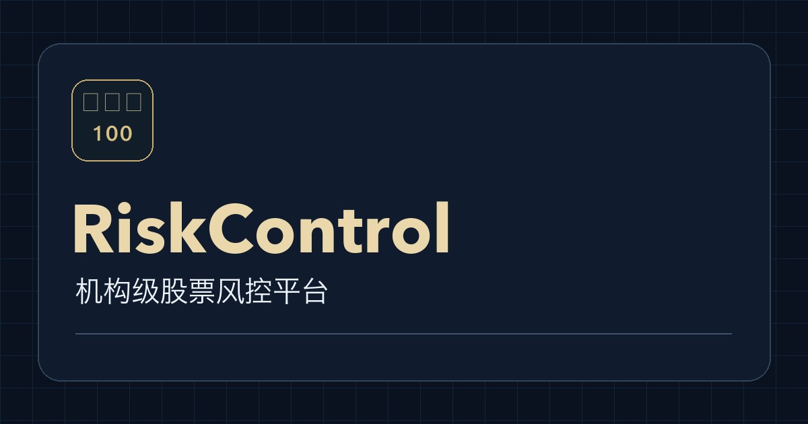

<div align="center">
  
  <h1>RiskControl</h1>
  <p>Win100 机构级股票风控平台</p>
</div>



## 功能

- **风控大盘** · 查看批次风险、行情、资产价值、收益率和补仓缺口。
- **补仓与结算** · 支持股票或现金补仓、客户退出、分成和 WIN100 台账。
- **客户管理** · 按批次录入客户，实时预览 VIP 档位和分成，商务经理可选填。
- **风险提醒** · 支持 Telegram 和邮件，管理员可指定系统账号或外部邮箱接收邮件。
- **操作留痕与备份** · 授权角色可下载操作记录，首位超级管理员可逐条删除并留下删除记录。支持加密业务备份。
- **品牌与分享** · 浏览器标签使用 Win100 标志，网页包含中文描述及 WhatsApp 等渠道使用的 Open Graph 分享图。

## 本地开发

使用 Node.js、Next.js 15、React、TypeScript、Tailwind CSS、Prisma 和 PostgreSQL。

```bash
npm ci
cp .env.example .env.local
npm run dev
```

按需配置本地数据库连接及登录密钥。打开 [本地工作台](http://localhost:3000)。

## 部署与验证

生产环境从服务器账本读取业务数据。部署执行数据库迁移，初始账号由管理员按运维文档手动创建。部署若使用访问保护，外部分享预览需要能访问公开登录页和分享图。

- [上线与运维](docs/上线与运维.md)
- [每日数据与备份](docs/daily-data-and-backup.md)

```bash
npx tsc --noEmit
npm run verify:finance
npm run verify:hardening
npm run verify:notification-policy
npm run verify:daily
```
